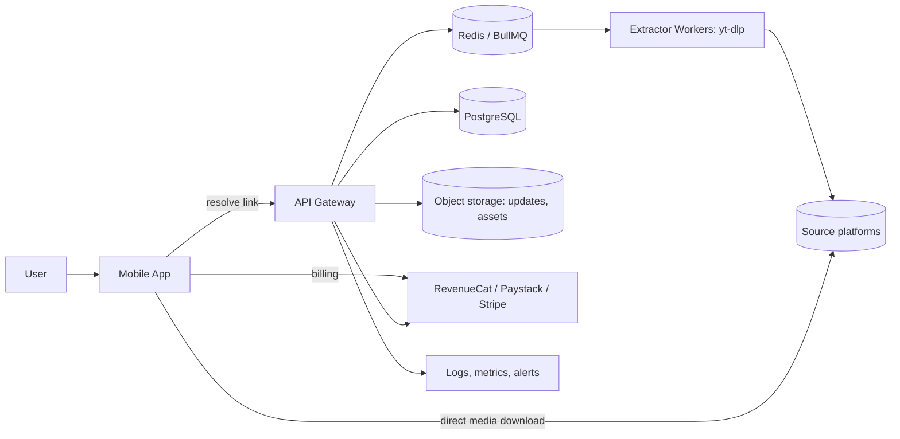
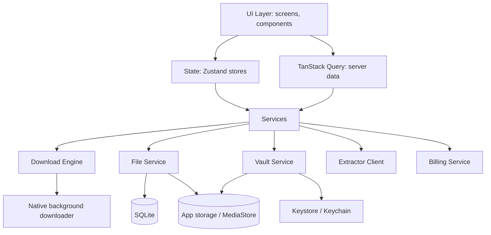
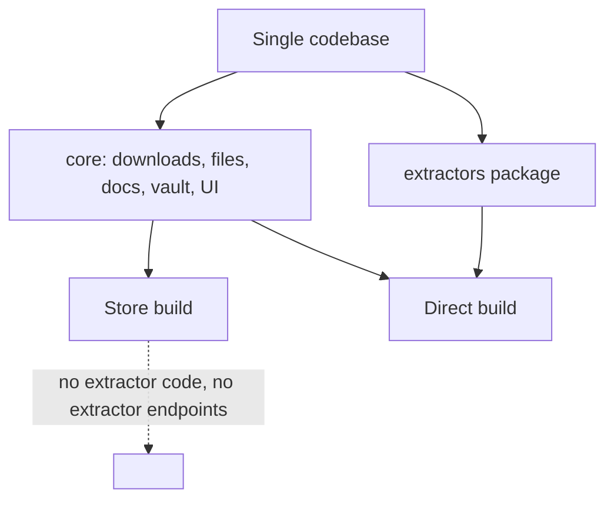
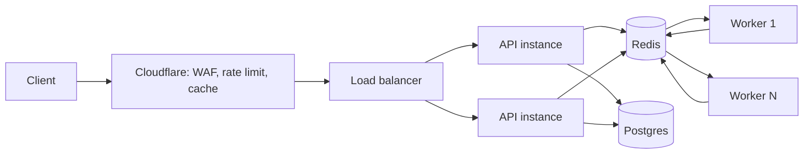
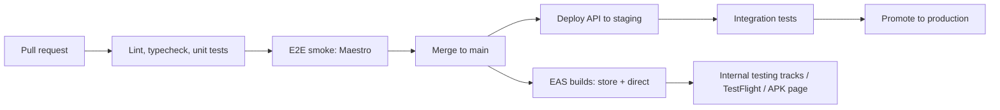

# System Architecture

## 1. System context



**Key design choice:** the server only _resolves_ links (returns metadata and direct media URLs). The phone downloads the file straight from the source. This keeps your bandwidth cost near zero, scales cheaply, and means you never host or store users' media.

A proxy fallback exists only for sources that need special headers or cookies.

## 2. Mobile architecture



### Layers

| Layer    | Responsibility                                                       |
| -------- | -------------------------------------------------------------------- |
| UI       | Screens, components, animations. No business logic                   |
| State    | Zustand for UI and queue state, TanStack Query for server data       |
| Services | Pure TypeScript modules with clear interfaces, easy to mock in tests |
| Native   | Background download session, file access, biometric, encryption      |

### Download engine

- Queue persisted in SQLite so tasks survive app kills
- States: `queued -> resolving -> downloading -> paused -> verifying -> completed | failed | canceled`
- Segmented/ranged requests where the source supports it, resume via `Range` header
- Concurrency limit (1 free, 5 Pro), exponential backoff on failure (max 3 retries)
- Uses a native background downloader (Android WorkManager / foreground service, iOS URLSession background) through a library or a small custom Expo module
- Hash check or size check on completion, then index in library

### Offline behavior

Library, viewer, player, vault, and doc tools work fully offline. Only link resolving, updates, and billing need network.

## 3. Flavor strategy (store vs direct)



Implementation:

- `APP_VARIANT=store|direct` read in `app.config.ts`, which sets name, package ID, icon, and feature flags
- EAS build profiles: `store-android`, `store-ios`, `direct-android`
- `src/features/extractors/` is imported only through a `loadExtractors()` function that the store build replaces with a no-op via Metro module aliasing, so the code is not in the store binary
- Feature flags exposed from one typed object, `FEATURES`, so UI never checks the variant directly
- Separate signing keys, package IDs, and store listings

```ts
// config/features.ts (shape)
export const FEATURES = {
  socialExtraction: VARIANT === 'direct',
  inAppBrowserDetection: VARIANT === 'direct',
  selfUpdater: VARIANT === 'direct',
  billing: VARIANT === 'direct' ? 'license' : 'iap',
} as const;
```

## 4. Backend architecture



| Component | Tech                                           | Notes                                           |
| --------- | ---------------------------------------------- | ----------------------------------------------- |
| API       | Fastify + TypeScript, Zod validation           | Stateless, horizontally scalable                |
| Queue     | BullMQ on Redis                                | Resolve jobs with priority (Pro first)          |
| Workers   | Node + yt-dlp binary in Docker                 | Autoscale on queue depth                        |
| DB        | PostgreSQL                                     | Users, devices, entitlements, releases, reports |
| Cache     | Redis                                          | Resolved metadata, short TTL                    |
| Storage   | S3-compatible (R2, S3)                         | APK releases, extractor manifests               |
| Auth      | Device token (anonymous) plus optional account | JWT access, rotating refresh                    |

### Resolve request lifecycle

1. App sends `POST /v1/resolve` with the URL.
2. API validates URL, checks rate limit and entitlement.
3. Cache hit (normalized URL key, TTL 5 to 15 min) returns immediately.
4. Cache miss creates a BullMQ job. API waits briefly (up to ~8s) or returns a job ID to poll.
5. Worker runs yt-dlp in a sandbox with timeout, returns formats and direct URLs.
6. API normalizes the response and returns it. App downloads directly from the source.

### Extractor maintenance (the biggest operational risk)

- Pin yt-dlp version per worker image, update on a schedule
- **Canary job:** every hour, resolve a fixed list of test URLs per platform, alert if success rate drops below threshold
- **Extractor manifest:** server tells the app which platforms are currently healthy, so the UI can show "Temporarily unavailable" instead of failing mysteriously
- Roll out worker image updates gradually (blue/green), keep the previous version for rollback
- Optional on-device fallback for simple platforms later

## 5. Scalability plan

| Stage  | Users          | Setup                                                                                   |
| ------ | -------------- | --------------------------------------------------------------------------------------- |
| MVP    | up to 5k MAU   | 1 API instance, 1 to 2 workers, managed Postgres and Redis                              |
| Growth | 5k to 100k MAU | 2 to 4 API instances, autoscaling workers, Cloudflare caching, read replica             |
| Scale  | 100k+ MAU      | Multi-region API, worker pools per region, rotating egress IP pool, sharded rate limits |

Techniques:

- **Stateless API** so any instance can serve any request
- **Metadata caching** collapses repeated resolves of viral links into one worker job (request coalescing)
- **Priority queues:** Pro and interactive requests ahead of batch
- **Backpressure:** reject with `429` plus `Retry-After` when queue depth is high
- **Client does the heavy lifting:** downloads, transcoding (only if needed), file management all on device
- **Cost control:** worker CPU is the main cost, so cap resolve timeouts and cache aggressively
- **Egress/IP reputation:** platforms block data-center IPs, so plan a residential or rotating proxy pool as you grow

## 6. Observability

- **Logs:** structured JSON (pino), no URLs or personal data beyond hashed domains
- **Metrics:** resolve latency, success rate per platform, queue depth, worker CPU, cache hit rate
- **Tracing:** OpenTelemetry on API and workers
- **Errors:** Sentry on app and backend
- **Alerts:** extraction success below 90%, queue depth, 5xx rate, p95 latency
- **Product analytics:** PostHog or similar, event names in `ANALYTICS.md` (add later), opt-out toggle in settings

## 7. CI/CD



- GitHub Actions, EAS Build and EAS Update (OTA for JS-only fixes in store builds)
- Staging and production environments with separate databases and keys
- Database migrations with a versioned tool (Drizzle or Prisma), run in CI

## 8. Recommended repository layout

```
mediavault/
  apps/
    mobile/                  Expo app
      src/app/               Expo Router screens
      src/
        features/
          downloads/  library/  documents/  vault/  player/  billing/  settings/
          extractors/        (direct flavor only)
        components/          shared UI
        services/            db, fs, crypto, api client, analytics
        stores/              Zustand stores
        config/              features, theme, constants
        utils/
      app.config.ts
      eas.json
    api/                     Fastify backend
      src/ routes/ plugins/ jobs/ lib/
    worker/                  yt-dlp worker
  packages/
    shared/                  shared types, zod schemas
  docs/                      these MD files
  .github/workflows/
```

Use a pnpm or Turborepo monorepo so the app and API share the same types.

## 9. Tech decisions and trade-offs

| Decision      | Choice                           | Why                                               | Alternative                              |
| ------------- | -------------------------------- | ------------------------------------------------- | ---------------------------------------- |
| App framework | React Native + Expo (dev client) | Fastest delivery, matches your React/TS skill set | Flutter, native Kotlin/Swift             |
| Local DB      | expo-sqlite                      | Simple, reliable, queryable                       | WatermelonDB for very large libraries    |
| Extraction    | Server-side yt-dlp               | Updatable without app release                     | On-device extraction, harder to maintain |
| Downloads     | Client direct from source        | Zero bandwidth cost, no hosting liability         | Proxy through your server                |
| Queue         | BullMQ                           | Simple, proven, Node-native                       | SQS, RabbitMQ                            |
| Billing       | RevenueCat (store)               | Cross-platform entitlements                       | Native IAP directly                      |
