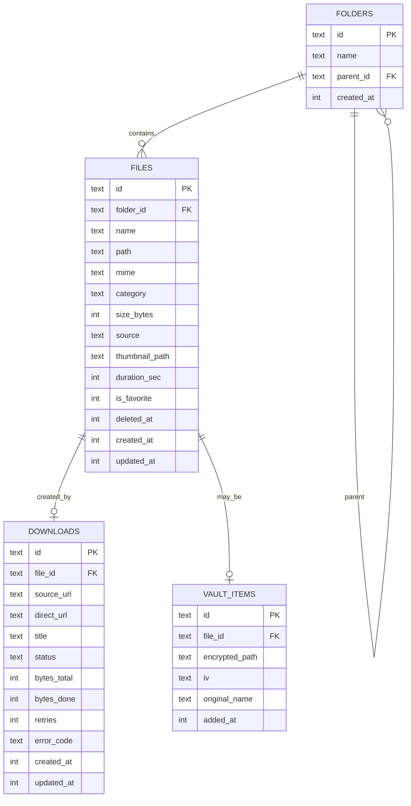
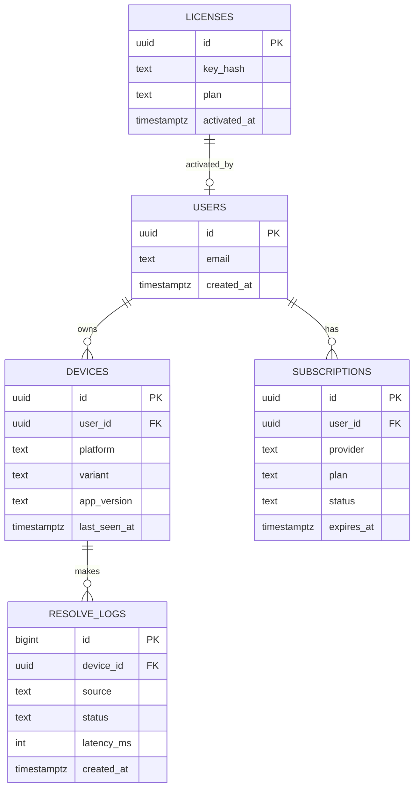

# Database Schema

## 1. Local database (SQLite, on device)



```sql
CREATE TABLE folders (
  id TEXT PRIMARY KEY, name TEXT NOT NULL, parent_id TEXT REFERENCES folders(id),
  created_at INTEGER NOT NULL
);

CREATE TABLE files (
  id TEXT PRIMARY KEY, folder_id TEXT REFERENCES folders(id),
  name TEXT NOT NULL, path TEXT NOT NULL, mime TEXT, category TEXT NOT NULL,
  size_bytes INTEGER, source TEXT, thumbnail_path TEXT, duration_sec INTEGER,
  is_favorite INTEGER DEFAULT 0, deleted_at INTEGER,
  created_at INTEGER NOT NULL, updated_at INTEGER NOT NULL
);
CREATE INDEX idx_files_category ON files(category, deleted_at);
CREATE INDEX idx_files_folder ON files(folder_id);
CREATE INDEX idx_files_name ON files(name);

CREATE TABLE downloads (
  id TEXT PRIMARY KEY, file_id TEXT REFERENCES files(id),
  source_url TEXT NOT NULL, direct_url TEXT, title TEXT,
  status TEXT NOT NULL, bytes_total INTEGER, bytes_done INTEGER DEFAULT 0,
  retries INTEGER DEFAULT 0, error_code TEXT,
  created_at INTEGER NOT NULL, updated_at INTEGER NOT NULL
);
CREATE INDEX idx_downloads_status ON downloads(status);

CREATE TABLE vault_items (
  id TEXT PRIMARY KEY, file_id TEXT, encrypted_path TEXT NOT NULL,
  iv TEXT NOT NULL, original_name TEXT, added_at INTEGER NOT NULL
);

CREATE TABLE settings (key TEXT PRIMARY KEY, value TEXT);
```

Notes:

- Use a migration table (`schema_version`) and run migrations at startup.
- Vault metadata (original names) should be encrypted at rest or stored with SQLCipher.
- Soft delete (`deleted_at`) powers the 30-day trash.

## 2. Server database (PostgreSQL)



Additional tables: `app_releases` (version, platform, apk_url, sha256, mandatory, changelog), `platform_health` (platform, status, success_rate, checked_at), `reports` (type, url_hash, note, status), `takedown_requests`, `rate_limit_overrides`.

Retention: `resolve_logs` keep 30 days, store only the source domain, never the full URL.
