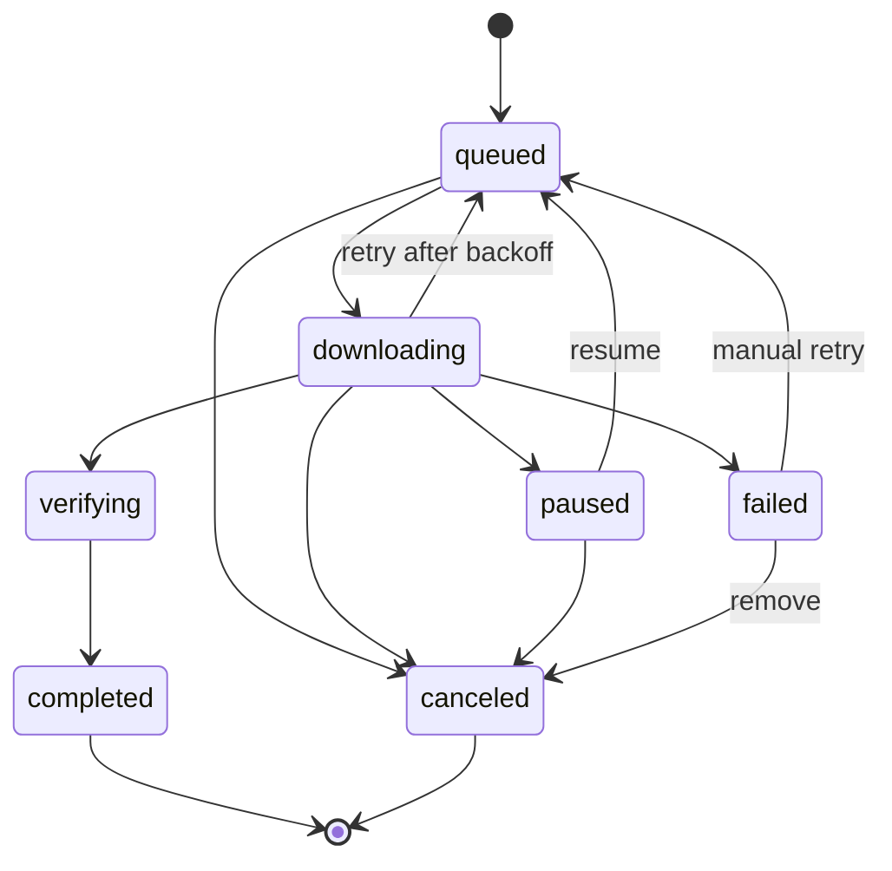

# Download Engine (Phase 1c)

Background downloads that survive the app being closed, the phone restarting, and bad networks.

## Pieces

| Piece                           | Where                                                  | Job                                                                    |
| ------------------------------- | ------------------------------------------------------ | ---------------------------------------------------------------------- |
| `DownloadEngine`                | `features/downloads/engine.ts`                         | The queue: concurrency, pause/resume, retries, Wi-Fi rule, recovery    |
| `DownloadTransport` (interface) | `features/downloads/ports.ts`                          | What the engine needs from the system downloader                       |
| Background transport            | `features/downloads/adapters/background-downloader.ts` | Implements it with `@kesha-antonov/react-native-background-downloader` |
| `inspectLink`                   | `features/downloads/inspect-link.ts`                   | Asks the server for name, type and size before downloading             |
| State machine, retry policy     | `state-machine.ts`, `retry.ts`                         | Pure rules, fully unit tested                                          |

The library sits behind `DownloadTransport`. If it ever fails on a real device, only one file changes.
Rows in SQLite are the source of truth, so the queue is the same after a restart.

## States

Illegal moves throw. `resolving` is reserved for the Phase 2 link resolver.

## Rules

- **Concurrency:** 1 at a time for free users, 5 for Pro. Pro is not wired yet (billing is Phase 3b), so everyone gets 1.
- **Retries:** up to 3, waiting 2 s, 4 s, then 8 s. Only for errors worth retrying (network, server 5xx, 408, 429, incomplete file).
  Not retried: 404, 410, 401, 403, out of space, library import failure. A manual Retry resets the count.
- **Wi-Fi only:** nothing starts on mobile data, and a running download is paused when Wi-Fi drops and resumed when it returns.
  Offline works the same way ("Waiting for a connection"). A download the user paused is never auto-resumed.
- **Verification:** a finished file smaller than the announced size counts as incomplete and is retried.
- **Finishing:** the file is moved into the library (`FileService.importFile`), so it shows up with the right name, type and folder.
- **Duplicates:** pasting a link that is already queued or downloading returns the existing download.

## After the app closes

On launch the engine asks the system which transfers it still holds and reconciles them with the database:

| Situation                                                 | Result                                  |
| --------------------------------------------------------- | --------------------------------------- |
| System still downloading                                  | Reconnects and carries on               |
| Finished while the app was closed                         | Imported into the library               |
| Paused and still held                                     | Stays paused, resumes where it left off |
| System lost it (reboot, cleared) and the file is complete | Imported                                |
| System lost it and the file is not complete               | Starts again from zero                  |
| System holds a transfer we do not know                    | Cancelled                               |

All of these are covered by `__tests__/download-recovery.test.ts`.

## Notifications

Provided by the library, not by us:

- **Android:** a progress notification while downloading, a "download complete" notification, and a Cancel button (Android 14+).
  Tapping Cancel is treated as a cancel, not a failure. Android 13+ asks for notification permission once, on the first download.
  Downloads still work if the user says no.
- **iOS:** no progress notification during a download. iOS also cancels background transfers if the user force-quits the app. This is an iOS rule that no library can avoid.

## Things to know

- **Plain `http://` links** are blocked by Android in release builds. The preview sheet suggests trying `https://`.
- **Web pages are not files.** A link that returns an HTML page is refused with a clear message. Saving videos from sites arrives with the resolver (Phase 2).
- **Queue actions are buttons, not swipes.** Visible buttons are easier to find and work with screen readers. Swipe actions can be added later.
- **Play Store:** the library declares a `dataSync` foreground service and `RUN_USER_INITIATED_JOBS`.
  Google Play requires a declaration form for foreground services. Plan for it in the launch checklist.

## Test on a real phone before trusting it

The engine logic is tested with a fake transport. The real transport is not tested yet. Please try these on Android first, then iPhone:

1. Download a large file, swipe the app away mid-download. Does it keep going? Reopen: does the queue show it?
2. Same, then restart the phone. Does it restart or resume?
3. Turn on airplane mode mid-download, then off. Does it wait and continue?
4. Turn on Wi-Fi only, switch to mobile data. Does it pause? Back to Wi-Fi: does it resume?
5. Pause, then Resume. Does it continue from the same place, not from zero?
6. Cancel from the notification (Android 14+).
7. Fill the phone's storage. Is the error message sensible?
8. Start two downloads. Does the second wait for the first?
9. After a download finishes, does the file appear in Library and open?

Report anything odd with the exact steps. The error-code mapping in `retry.ts` is based on documented Android and iOS
codes, and real devices may report others.
