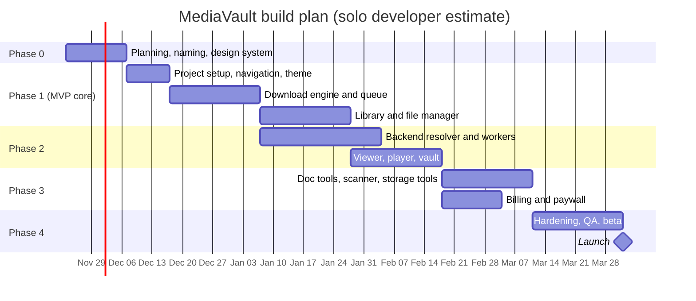

# Roadmap, Testing, and Launch

## 1. Phases

Estimated total: about 5 to 6 months solo, 3 to 4 months with 2 to 3 people. Treat dates as a starting guess and adjust after Phase 1.

### Phase 0: Foundations (2 weeks)

- Final name, brand, domains, package IDs
- Design system in Figma, key screens designed
- Repo, monorepo, CI, EAS profiles for both flavors
- Legal basics: terms, privacy policy drafts

### Phase 1: Core app (about 7 weeks)

- Navigation shell, theme, onboarding
- SQLite setup and migrations
- Download engine: queue, background, pause/resume, persistence
- Direct-link downloads working end to end
- Library with folders, search, sort, bulk actions

### Phase 2: Resolver and media (about 5 weeks)

- Backend: auth, `/resolve`, workers, caching, rate limits
- Share-sheet and clipboard detection
- Platform health endpoint and canary tests
- Video/audio player, image and PDF viewer
- Vault with PIN and biometrics

### Phase 3: Differentiators and money (about 3 weeks)

- Scanner, PDF merge/split, convert
- Storage dashboard, duplicate finder, trash
- Billing: RevenueCat (store), Paystack/Stripe license (direct)
- Paywall and entitlements

### Phase 4: Hardening and launch (3 weeks)

- Performance and battery tuning, accessibility pass
- Security checklist, load test of the resolver
- Closed beta (50 to 200 users), crash and feedback loop
- Store listings, screenshots, landing page for APK

### After launch

- Weekly extractor maintenance, monthly feature release
- Localization, annotations, OCR, cloud backup, tablet layouts

## 2. Testing strategy

| Level              | Tools                            | Focus                                                             |
| ------------------ | -------------------------------- | ----------------------------------------------------------------- |
| Unit               | Jest                             | Services, queue state machine, URL normalization, crypto helpers  |
| Component          | React Native Testing Library     | Screens and states (empty, loading, error)                        |
| Integration        | Jest + test DB                   | API routes, resolve flow, entitlements                            |
| E2E                | Maestro                          | Onboarding, paste and download, library actions, vault unlock     |
| Contract           | Zod schemas in `packages/shared` | App and API stay in sync                                          |
| Device matrix      | Real devices                     | Android 9 to 15 (low-end included), iOS 16+, various screen sizes |
| Extractor canaries | Scheduled job                    | Hourly test URLs per platform                                     |
| Load               | k6                               | Resolver under burst, queue backpressure                          |
| Security           | Manual and tooling               | SSRF, updater tampering, vault crypto                             |

Key test cases for downloads: app killed mid-download, network switch, low storage, duplicate file names, expired direct URL (re-resolve and resume), very large files.

## 3. Definition of done (per feature)

- Acceptance criteria in PRD met
- Empty, loading, error, offline states implemented
- Unit tests for logic, one E2E path for critical flows
- Works in both flavors (or correctly disabled in one)
- No new lint, type, or audit errors
- Analytics events added, no personal data logged

## 4. Launch checklist

**Store flavor**

- [ ] Listing copy avoids "download from YouTube/Instagram" wording, focuses on media and file management
- [ ] Data Safety / Privacy Labels completed
- [ ] Content rating, target age, ads declaration
- [ ] In-app purchase products configured and tested with test accounts
- [ ] Review notes and a demo path for reviewers (direct-link download example)
- [ ] Internal, closed, then open testing track (Play requires a closed test period for new personal accounts)

**Direct flavor**

- [ ] Landing page with install instructions and SHA-256
- [ ] Signing key in KMS, release pipeline tested
- [ ] Updater tested for upgrade, downgrade block, tampered file
- [ ] Payment flow and license activation tested end to end

**Both**

- [ ] Monitoring, alerts, and on-call plan
- [ ] Support email, FAQ, takedown contact page
- [ ] Rollback plan for backend and app
- [ ] Press kit: logo, screenshots, short demo video

## 5. KPIs to watch after launch

Activation rate, download success rate, extraction success per platform, crash-free rate, D1/D7/D30 retention, Pro conversion, refund rate, average queue wait time, support tickets per 1,000 users.

## 6. Risks to review monthly

Platform blocks or format changes, store policy updates, rising worker cost, legal notices, dependency vulnerabilities.
