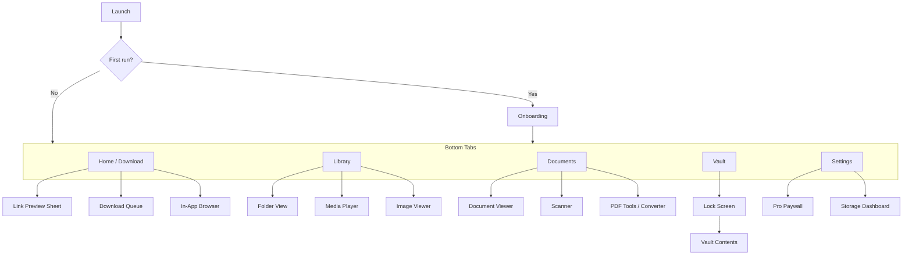

# Screens and Navigation

## 1. Navigation structure

Bottom tab bar with 5 tabs. Everything else is a stack screen or modal on top.



Routing (Expo Router):

```
app/
  _layout.tsx              root stack, theme, providers
  onboarding.tsx
  (tabs)/
    _layout.tsx            tab bar
    index.tsx              Home
    library/index.tsx
    documents/index.tsx
    vault/index.tsx
    settings/index.tsx
  preview/[id].tsx         modal: link preview and quality picker
  queue.tsx
  browser.tsx
  player/[fileId].tsx
  viewer/[fileId].tsx
  folder/[folderId].tsx
  scanner.tsx
  tools/[tool].tsx         merge, split, convert
  paywall.tsx              modal
  storage.tsx
```

## 2. Screen inventory

### Onboarding (3 slides)

- Slides: "Save from anywhere", "Everything organized", "Private by design"
- Permission asks happen later, in context, never up front
- Components: pager, primary CTA, skip

### Home (Download)

- **Purpose:** the fastest path to a download
- **Components:** large paste field with Paste button, clipboard banner ("Link detected, download?"), supported-sources chips, active downloads strip, recent downloads
- **States:** empty (illustration plus "Paste your first link"), loading preview, error (unsupported link, network, rate limit)

### Link Preview Sheet (modal)

- Thumbnail, title, source, duration, size estimates
- Format tabs: Video / Audio
- Quality list (Pro badges on locked options)
- Save-to folder selector, Download button

### Download Queue

- Segmented control: Active / Completed / Failed
- Row: thumbnail, title, progress bar, speed, ETA, pause/resume/cancel
- Swipe actions, bulk clear, retry failed

### In-App Browser (direct flavor)

- URL bar, tabs, detected-media floating button, download sheet

### Library

- Top: search, sort, view toggle (grid/list)
- Category chips: All, Video, Audio, Images, Other
- Smart collections: Recent, Favorites, By Source
- Multi-select bar: move, share, delete, add to vault
- Empty state per category

### Media Player

- Video: gestures, speed, PiP, subtitles, lock-rotation
- Audio: artwork, mini-player, background and lock-screen controls

### Documents

- Sections: Recent, All Documents, Scans
- FAB: Scan, Import, Create PDF from images
- Tool cards: Merge, Split, Convert, Compress

### Document Viewer

- PDF: page thumbnails, jump to page, search, share
- Office files: render or open with system viewer
- Toolbar: share, rename, move, add to vault

### Scanner

- Camera with edge detection, auto-capture, multi-page strip
- Review: crop, filter (color, grayscale, B/W), reorder, save as PDF

### Vault

- **Lock screen:** PIN pad, biometric prompt, attempt counter
- **Contents:** same layout as Library, with a lock-now button and encryption badge
- Import from Library or device gallery, export back out

### Storage Dashboard

- Donut chart by category, duplicate finder, large-file list, one-tap cleanup

### Settings

- Account/Pro status, download defaults (quality, folder, Wi-Fi only, concurrent limit)
- Appearance (theme, accent), security (vault PIN, biometrics, auto-lock)
- About, legal (terms, privacy, takedown contact), check for updates (direct), support

### Paywall (modal)

- Benefit list, plan cards (yearly highlighted), trial note, restore purchases, legal links

## 3. Design system

### Principles

1. Dark-first, high contrast, content is the hero (thumbnails)
2. One accent color, used sparingly for primary actions and progress
3. Motion with purpose: shared-element transitions to the player, spring animations on sheets
4. One-handed reach: key actions in the lower half of the screen

### Tokens

| Token          | Dark      | Light     |
| -------------- | --------- | --------- |
| Background     | `#0B0D12` | `#F7F8FA` |
| Surface        | `#151922` | `#FFFFFF` |
| Surface raised | `#1D2230` | `#EEF0F4` |
| Primary accent | `#6C5CE7` | `#5B4BD6` |
| Success        | `#2ECC71` | `#1FA85A` |
| Danger         | `#FF5C5C` | `#E04545` |
| Text primary   | `#F2F4F8` | `#12141A` |
| Text secondary | `#9AA3B5` | `#5A6275` |

- **Type:** Inter (or Satoshi), 12/14/16/20/28 scale
- **Radius:** 12 for cards, 20 for sheets, full for chips
- **Spacing:** 4-point grid
- **Icons:** Lucide
- **Libraries:** react-native-reanimated, react-native-gesture-handler, @gorhom/bottom-sheet, expo-haptics, Skia for the storage chart

### Required states for every list or screen

Loading (skeleton), empty (illustration plus CTA), error (message plus retry), offline, permission denied.

## 4. Accessibility

- Minimum 44pt touch targets, labels on all icons, dynamic type support
- Contrast ratio 4.5:1 or higher, reduce-motion setting respected
- Screen reader order tested on Home, Library, and Player
