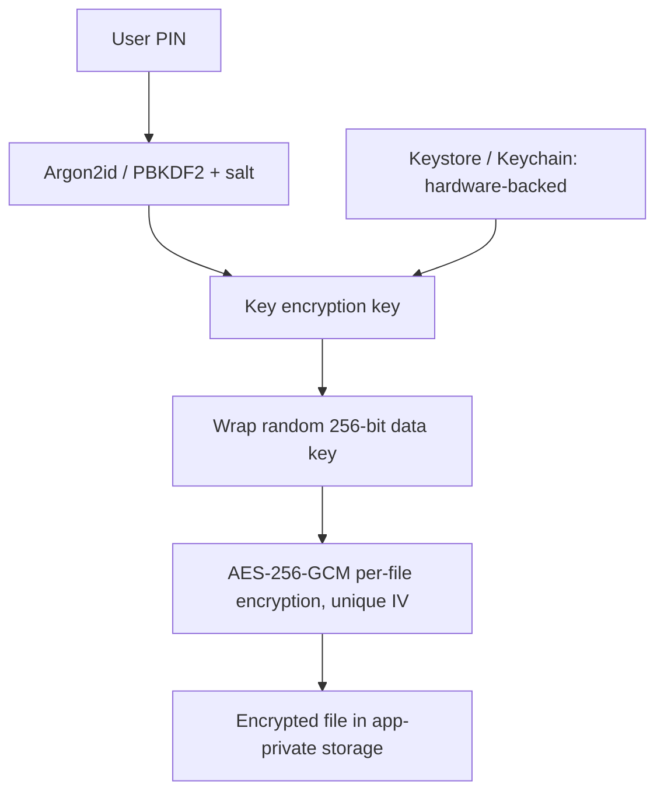

# Security and Privacy

## 1. Principles

1. Collect as little data as possible. Never host users' media.
2. Encrypt sensitive files on device, keys never leave the secure hardware.
3. Treat every URL and server response as untrusted input.
4. Make the direct (APK) distribution as trustworthy as the store build.

## 2. Threat model

| Threat                                | Asset                     | Mitigation                                                |
| ------------------------------------- | ------------------------- | --------------------------------------------------------- |
| Lost or borrowed phone                | Vault files               | AES-256-GCM encryption, biometric/PIN, auto-lock          |
| Malicious link / SSRF                 | Backend, internal network | URL validation, block private IPs, sandboxed workers      |
| Tampered APK or fake update           | Users of direct flavor    | Signature and hash verification, HTTPS only, pinned cert  |
| Man-in-the-middle                     | API traffic, tokens       | TLS 1.2+, certificate pinning                             |
| API abuse / scraping of your resolver | Server cost               | Rate limits, device attestation, WAF                      |
| Leaked secrets                        | API keys, signing keys    | Secrets manager, no keys in app bundle, CI-only signing   |
| Malicious downloaded file             | Device                    | No auto-execute, safe file-type handling, warn on APK/EXE |
| Webhook forgery                       | Entitlements              | Verify signatures, idempotency keys                       |
| Data leakage in logs                  | Privacy                   | No URLs or personal data in logs, hashed domains only     |

## 3. Vault design

- Each file gets its own IV, authenticated encryption (GCM) detects tampering
- Large files are encrypted in chunks (for example 1 MB) so video can stream and seek
- Data key is wrapped by a key stored in Android Keystore / iOS Keychain, bound to biometrics where available
- Vault files live in app-private storage and are excluded from the media index and gallery
- Attempt limiting: exponential cooldown after 5 failed PINs
- Android: `FLAG_SECURE` to block screenshots and recents thumbnail in vault
- Honest messaging: if the user forgets the PIN and has no recovery option, the files are unrecoverable. Offer an optional recovery key at setup.

## 4. Mobile hardening

- **Secure storage:** tokens in `expo-secure-store`, never AsyncStorage
- **Transport:** HTTPS only, certificate pinning for the API domain
- **Root/jailbreak signals:** detect and warn (do not hard-block), log silently
- **Obfuscation:** enable Hermes bytecode and R8/ProGuard, strip console logs in release
- **Permissions:** request the minimum, in context. Use scoped storage and MediaStore on Android, avoid `MANAGE_EXTERNAL_STORAGE` unless unavoidable
- **Deep links and share intents:** validate and sanitize all incoming URLs
- **Clipboard:** read only when the app is foregrounded and the user has enabled detection
- **Backups:** exclude vault directory and tokens from Android auto-backup
- **Dependencies:** lock files, `npm audit` and Dependabot in CI

## 5. Backend hardening

- **SSRF protection (critical for a link resolver):**
  - Allow only `http`/`https`, ports 80 and 443
  - Resolve DNS yourself and reject private, loopback, link-local, and metadata ranges (10.0.0.0/8, 172.16.0.0/12, 192.168.0.0/16, 127.0.0.0/8, 169.254.0.0/16, ::1, fc00::/7)
  - Re-check after redirects, limit redirect count
- **Worker sandbox:** run yt-dlp in a locked-down container (non-root, read-only filesystem, no access to internal network, CPU/memory/time limits, seccomp profile)
- **Input validation:** Zod on every route, max body size, strict content types
- **AuthN/Z:** short-lived JWT access tokens (15 min), rotating refresh tokens, entitlements checked server-side only
- **Rate limiting:** per device, per IP, and global, backed by Redis
- **Abuse prevention:** Play Integrity API (Android) and App Attest (iOS) for store builds, signed request headers for direct builds
- **Headers and platform:** WAF in front, CORS locked, Helmet defaults, DDoS protection through Cloudflare
- **Secrets:** managed secret store, rotate regularly, separate staging and production
- **Database:** least-privilege DB user, encrypted at rest, daily backups with restore tests
- **Webhooks:** verify HMAC signatures, replay protection

## 6. Safe distribution of the direct APK

- Host on your own HTTPS domain with a clear landing page and changelog
- Publish the SHA-256 of every release
- Sign every release with the same long-lived key, store the key in a hardware or cloud KMS, never in the repo
- In-app updater checks: HTTPS, hash match, and signing certificate fingerprint match before handing off to the installer
- Use Android's `REQUEST_INSTALL_PACKAGES` only in the direct flavor
- Do not bundle third-party ad SDKs that behave like malware, since this is what gets sideloaded apps flagged by Play Protect

## 7. Privacy

- **Data collected:** anonymous device ID, app version, coarse analytics, domain-level resolve logs. No media content, no contact lists, no precise location
- **Policy:** clear Privacy Policy and Terms linked in onboarding, Settings, and store listings
- **User controls:** analytics opt-out, delete account and data, export data
- **Regulations:** GDPR and NDPR (Nigeria) alignment, data-processing agreements with vendors, children's data not knowingly collected (age gate 13+, 16 where required)
- **Store forms:** Play Data Safety and Apple Privacy Labels filled accurately

## 8. Legal and content safety

- Terms of Use: for personal use and content the user has the right to download
- No DRM circumvention, no bundled copyrighted content, no hosting of user media
- Public takedown and contact page, response process within a defined time (for example 72 hours)
- Disable specific sources quickly through the platform-health manifest if a rights holder or platform requires it
- Get a legal review before launch, especially for the direct flavor's extraction feature, since rules differ by country

## 9. Security checklist before launch

- [ ] SSRF tests passed on resolver (private IPs, redirects, DNS rebinding)
- [ ] Worker container escape and resource-limit tests
- [ ] Vault encryption reviewed, key handling tested on real devices
- [ ] Certificate pinning with a backup pin and rotation plan
- [ ] Release keystore in KMS, backup stored securely offline
- [ ] Dependency audit clean, secrets scan in CI
- [ ] Rate limits and abuse alerts verified in staging
- [ ] Penetration test or at least an external review of API and updater
- [ ] Incident response plan and contact documented
