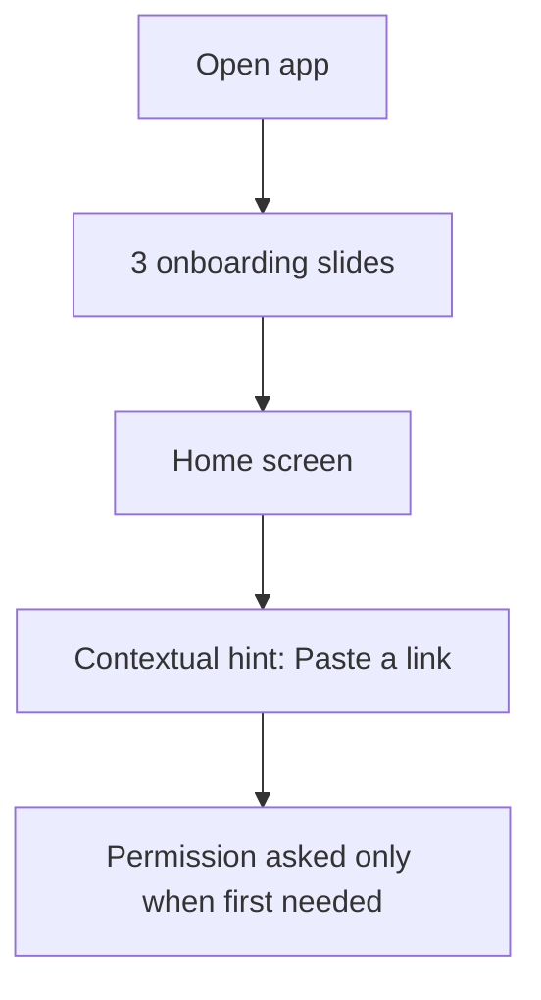
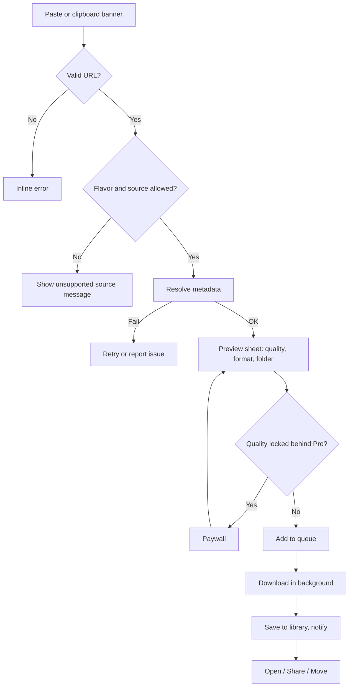
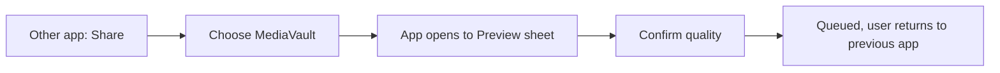
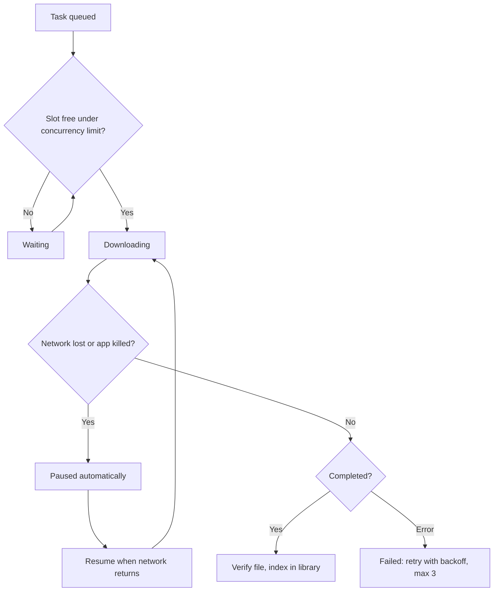
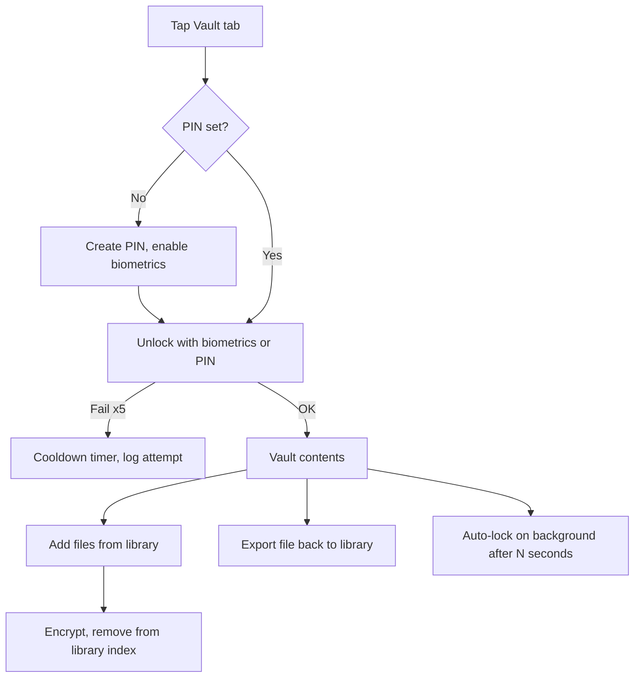
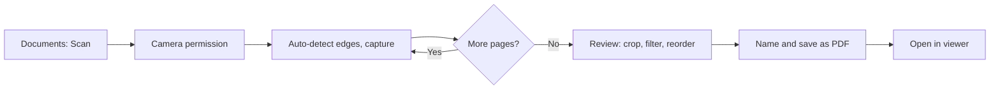
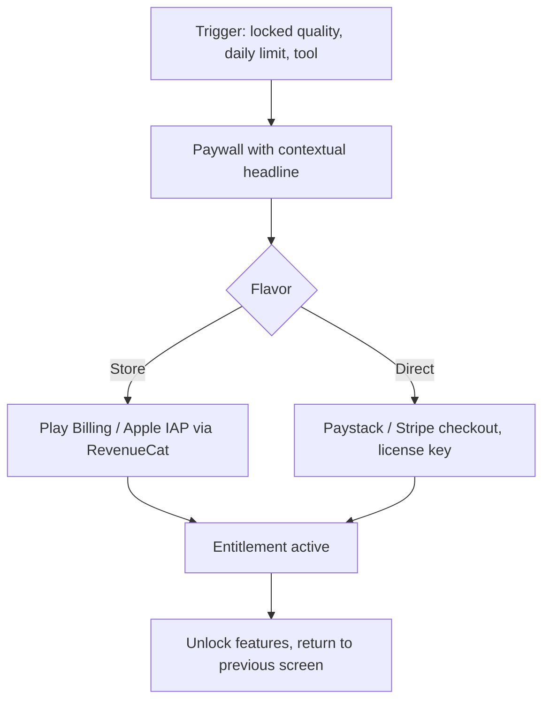
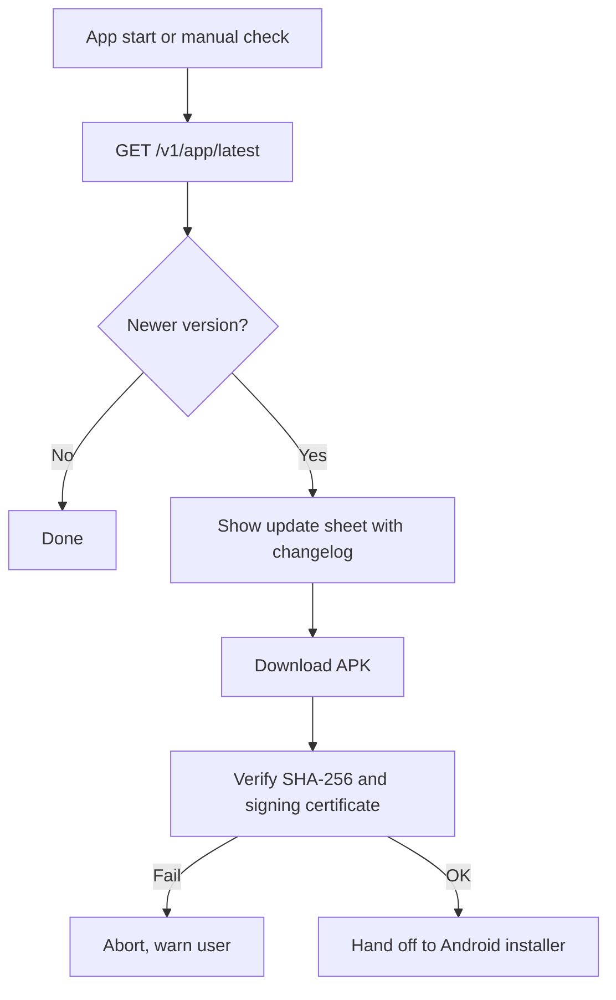

# User Flows

## 1. First launch and onboarding

## 2. Download from a pasted link

## 3. Share-sheet flow

## 4. Queue management

## 5. Vault

## 6. Scan to PDF

## 7. Upgrade to Pro

## 8. Direct flavor: app update

